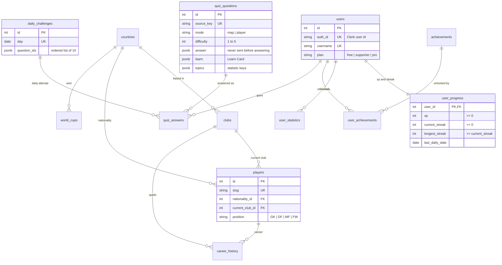

# Footlas database schema

PostgreSQL 16, managed with SQLAlchemy 2 models and Alembic migrations in `backend/`.
The tables follow the Notion "Database Schema" page and are grouped by domain, one
`models.py` per domain under `backend/app/domains/`. [ARCHITECTURE.md](ARCHITECTURE.md)
maps each Notion table name to its table.

## Diagram

## Rules the database enforces

These are CHECK constraints, so a bug in the API or a hand-written SQL fix can't store
an impossible row. They are named `ck_<table>_<rule>`.

| Table | Rule |
| --- | --- |
| `countries` | `confederation` is one of UEFA, CONMEBOL, CONCACAF, CAF, AFC, OFC; `world_cup_titles >= 0` |
| `clubs` | `founded` is empty or after 1800 |
| `players` | `position` is GK, DF, MF or FW |
| `career_history` | `end_year` is empty (still there) or not before `start_year` |
| `quiz_questions` | `mode` is `map` or `player`; `difficulty` is 1 to 5 |
| `daily_challenges` | `question_ids` is a JSON array |
| `quiz_answers` | `xp_awarded >= 0`; one answer per user, daily challenge and question |
| `users` | `plan` is `free`, `supporter` or `pro`; `auth_id` and `username` are unique |
| `user_progress` | `xp >= 0`; `current_streak >= 0`; `longest_streak >= current_streak` |
| `user_statistics` | `0 <= correct <= answered`; one row per user and key |
| `achievements` | `metric` is `correct` or `streak`; `threshold > 0` |

Every foreign key has an index, because Postgres doesn't add one on its own.
`tests/test_schema.py` fails if a new foreign key has none.

## Changing the schema

1. Edit the model in `backend/app/domains/<domain>/models.py`.
2. From `backend/`, run `alembic revision --autogenerate -m "what changed"` and read
   the generated file. Autogenerate does not see CHECK constraints, so add
   `op.create_check_constraint(...)` by hand for any new one.
3. Run `alembic upgrade head`, then `alembic check` (it should say no new operations),
   then `pytest`.
4. Never edit a migration that has run on a shared database; add a new one.

CI runs `alembic upgrade head`, `alembic check`, a full downgrade and upgrade again, so
a migration that can't be undone fails the build.

## Not in the MVP yet

From the Notion "Future Tables" list: managers, stadiums, competitions, referees,
transfers, seasons, matches. They go in the football domain. `daily_challenges.question_ids`
is a JSONB list for now; if daily challenges ever need per-question metadata, move it to a
`daily_challenge_questions` join table.
